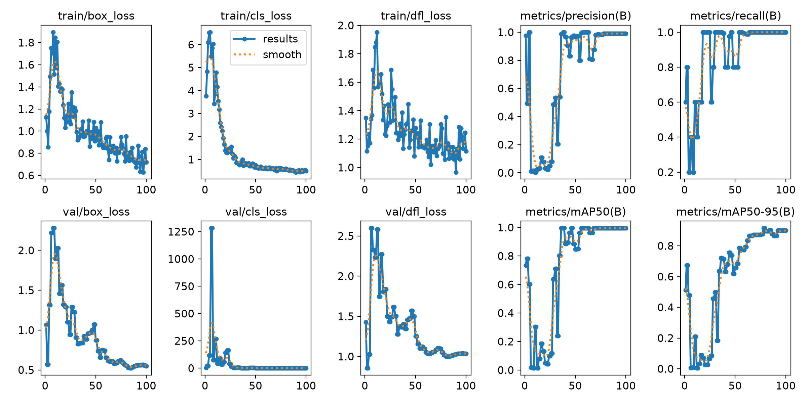
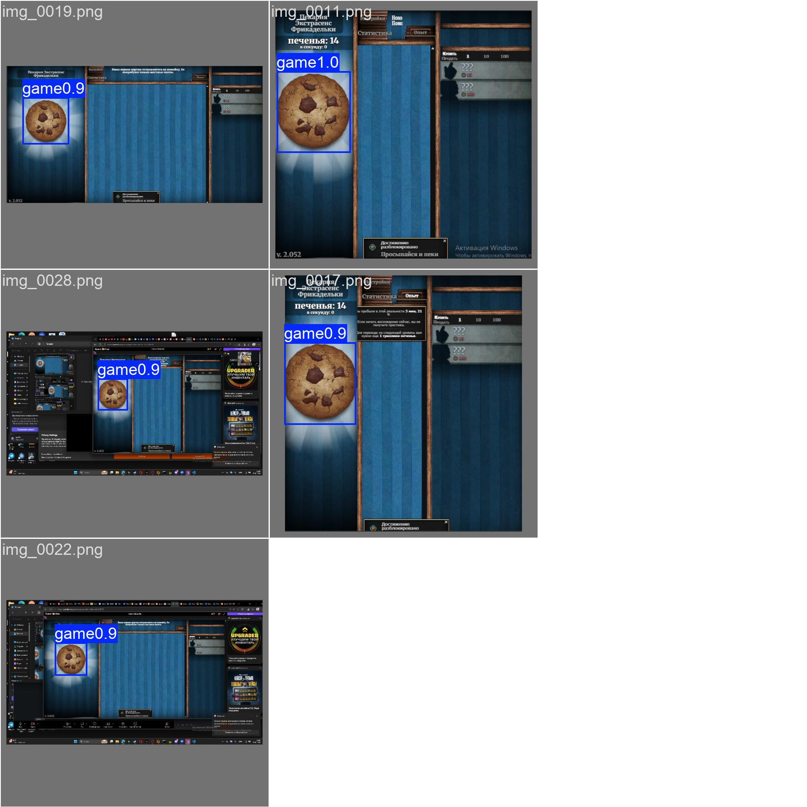

# Печенька: YOLO-автокликер

Программа сама играет в Cookie Clicker: делает скриншот экрана, нейросеть YOLOv8 находит печеньку и программа кликает по ней.

## Пайплайн

| Шаг | Файл | Что делает |
| --- | --- | --- |
| 1. Сбор данных | `screener.py` | автоматически снимает скриншоты игры каждые 3 с |
| 2. Разметка | X-AnyLabeling + `json_yolo.py` | рамки класса `game`, перевод разметки в формат YOLO |
| 3. Разделение | `split.py` | train / val = 80 / 20 |
| 4. Обучение | `train.py` | дообучение YOLOv8n, 100 эпох |
| 5. Внедрение | `app.py` | находит печеньку на экране и кликает |

## Результат обучения

- датасет: 28 размеченных скриншотов (23 train, 5 val);
- mAP50 = 0.995, mAP50-95 = 0.72, precision = 0.99, recall = 1.0.




## Запуск на своём компьютере

1. Скачать проект: зелёная кнопка **Code → Download ZIP**, распаковать в папку без кириллицы, например `C:\pechenka`.
2. Установить зависимости (Python 3.10–3.12):
   ```
   cd C:\pechenka
   python -m venv .venv
   .venv\Scripts\activate
   pip install -r requirements.txt
   ```
3. Открыть Cookie Clicker в браузере и запустить:
   - `python demo.py` — окно с тем, что видит нейросеть, + автоклики;
   - `python app.py` — только автокликер.

Остановка: клавиша Q в окне демо, Ctrl+C в терминале или мышь в левый верхний угол экрана.
